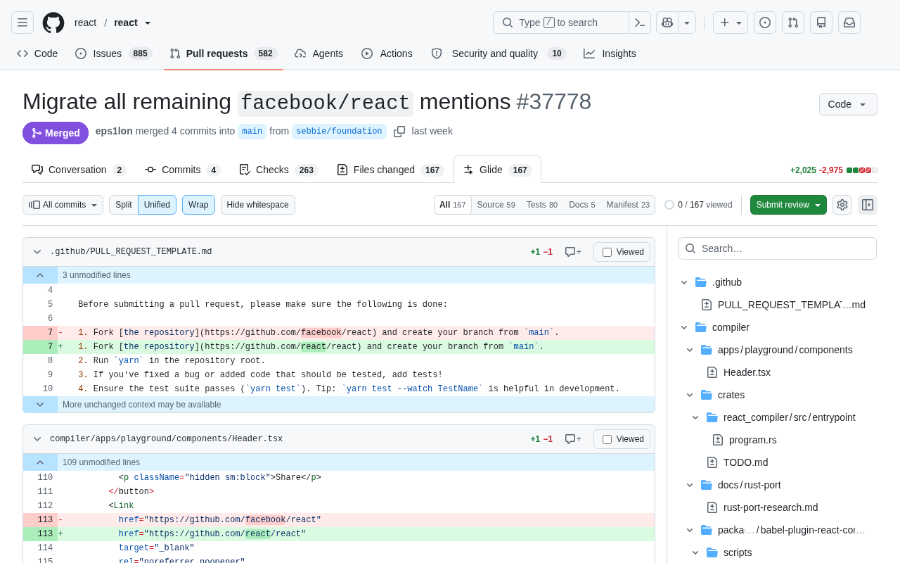

<p align="center"></p>

<h1 align="center">Glide for GitHub</h1>

A Chrome extension (Manifest V3) that adds a **Glide** tab next to **Files changed** on GitHub pull requests. The tab
shows the same pull request with a fast diff viewer and file tree, powered by
[Pierre](https://diffs.com) ([@pierre/diffs](https://www.npmjs.com/package/@pierre/diffs),
[@pierre/trees](https://www.npmjs.com/package/@pierre/trees)), and keeps the GitHub
review features: comments, suggestions, resolving threads, viewed files and review submission.



## What it does

- Renders every changed file in one fast, virtualized diff view (split or unified), with a file tree beside it.
- Comment on a line, a range of lines (drag over the gutter) or a whole file. The composer has a Write / Preview toggle
  and an "Insert suggestion" button.
- Threads show inline: reply, edit, delete your own comments, resolve and unresolve, react.
- Pending review: the Review button counts your pending comments; submit as Comment, Approve or Request changes, or
  discard the review.
- Apply a suggestion, or a batch of suggestions, as a commit (see the caveat below).
- Viewed checkboxes stay in sync with GitHub's own viewed state, in both directions.
- Commit range picker (all commits, one commit, a range) and hide-whitespace.
- Reading needs no token. Posting comments, replies, reviews, edits and reactions needs one (next section). Applying
  suggestions, resolving threads and marking files viewed use your signed-in GitHub session, so they work without a
  token.
- Display options (layout, themes, line wrapping, hunk rows, tree icons and position, fonts, and more) are on the
  options page and in the viewer's Display menu, with a live preview on the options page. Every option starts at
  "Default (GitHub)", which looks like GitHub's own Files changed page (unified, GitHub's colors, fonts and file boxes,
  slim expandable "N unmodified lines" rows instead of `@@` headers, file status icons but no status letters in the tree); Pierre's other styles are one choice away. Changes apply to open pull
  requests without a reload.

## Install

**From the Chrome Web Store:** coming soon (listing link to be added once the first version is published).

**From a release (unpacked):** download `glide-for-github.zip` from the
[latest release](https://github.com/dangh/glide-for-github/releases/latest), unzip it into a folder, open
`chrome://extensions`, turn on **Developer mode**, click **Load unpacked** and choose the folder.

**From source:**

1. Build it: `npm install && npm run build`. This writes the extension to `dist/`.
   (Or run `npm run zip` and unzip `glide-for-github.zip` into a folder of your own.)
2. Open `chrome://extensions` and turn on **Developer mode**.
3. Click **Load unpacked** and choose the `dist/` folder (or the unzipped folder).
4. Open any pull request on github.com. The **Glide** tab appears after **Files changed**. (Links ending in `#glide`
   open it directly; `#pierre` links from before the rename still work.)

Requires Node 20.19 or newer to build, and a Chromium-based browser that supports Manifest V3.

## Token setup

Reading a pull request works without a token, and so do applying suggestions, resolving threads and marking files viewed
(they use your signed-in GitHub session). To post comments, replies, reviews, edits or reactions, Glide asks for a
GitHub token the first time you need one. You can also add and remove tokens on the options page (right-click the
extension icon, then **Options**).

- **Fine-grained token (recommended).** Create it for the account or organization that owns the repositories, with
  **Pull requests: Read and write** and **Contents: Read**. The prompt links to GitHub's token page with these
  permissions filled in. A fine-grained token covers one owner, so add one per owner you review for.
- **Classic token.** Needs the `repo` scope (or `public_repo`, which works for public repositories only). One classic
  token can serve every owner ("Use this token for all owners").
- If your organization uses SAML SSO, authorize the token for it after creating it.
- Resolving threads and marking files viewed: with a token stored, Glide uses GitHub's GraphQL API first, which some
  fine-grained tokens cannot call. If no token is stored, or GitHub refuses it for that action, Glide uses your
  signed-in GitHub session instead. It asks for a token only if the session is refused as well.

## Privacy

- The extension only talks to GitHub: `github.com`, `api.github.com`, GitHub's image servers (for avatars and
  images in comments) and `raw.githubusercontent.com` (GitHub's file-content host, reached by redirect from github.com,
  used to expand unchanged context). The Preview tab of the comment box posts your draft text to github.com's `/preview`
  so GitHub can render it. No third parties; it has no server of its own, no analytics and loads no remote code.
- Your token is stored in `chrome.storage.local`, on this device only, with the GitHub username it belongs to. It is sent only to `api.github.com`, only from
  the extension's own pages, never to the github.com page, and the options page never displays it.
- Display settings are stored in `chrome.storage.sync`, so Chrome can sync them between your signed-in browsers. They
  contain no tokens and no pull request data.

## Private GitHub endpoints: please read

GitHub offers no public API for applying a suggestion, so **Apply suggestion** (single or batch) calls the same
**private endpoint GitHub's own page uses** (`page_data/apply_review_suggestions`), through your signed-in GitHub
session, not your token. The session fallback for **resolving threads** (`page_data/resolve_thread`,
`unresolve_thread`) and **marking files viewed** (`file_review`) uses private endpoints in the same way.

These can break without notice if GitHub changes them. When one fails, Glide says so and you can do the action on
GitHub instead. Comments, replies, reviews, edits and reactions use GitHub's documented REST and GraphQL APIs with your
token, and so do resolve and viewed whenever the token is allowed to.

## Performance

Measured with `npm run perf` (see `PERF.md` for the method, every run and the raw spread): Chrome for Testing 155,
headed, logged in, median of 3 runs.

| Metric | Result | Budget |
| --- | --- | --- |
| react/react#37778 (167 files), whole PR loaded | 4.80 s (worst run 5.36 s) | 6.5 s |
| microsoft/vscode#151512 (898 files), whole PR loaded | 10.51 s (worst run 10.84 s) | 22 s |
| Scrolling the 898-file PR top to bottom at 3,000 px/s | no long task; longest frame 27 ms | no task over 50 ms |
| Typing in a comment box on the 898-file PR, p95 keystroke to next frame | 12.6 ms | under 16 ms |

Load time depends on GitHub's server response times and varies with the time of day.

## Development

```
npm install
npm run build        # dist/
npm test             # unit tests (vitest)
npm run typecheck
npm run zip          # build and write glide-for-github.zip
npm run e2e          # headed Playwright tests against real GitHub, see playwright.config.ts for setup
npm run perf         # performance budget, see PERF.md
```

The end-to-end tests need the logged-in browser profile described in `playwright.config.ts`.

CI (`.github/workflows/build.yml`) type-checks, tests and zips every push and pull request. A `v*` tag that matches
`manifest.json`'s version also creates a GitHub release and, when the store secrets are set, publishes to the Chrome Web
Store. See [store/README.md](store/README.md) for the store listing and release steps.

## Credits and license

Glide's diff viewer and file tree are Pierre's: [@pierre/diffs](https://www.npmjs.com/package/@pierre/diffs) and
[@pierre/trees](https://www.npmjs.com/package/@pierre/trees), both Apache-2.0. Their licenses and those of the other
bundled packages ship in the extension as `THIRD_PARTY_NOTICES.txt`. Glide is not affiliated with Pierre or GitHub.

Glide's own code is released under the [MIT license](LICENSE). Privacy policy: [store/PRIVACY.md](store/PRIVACY.md).
